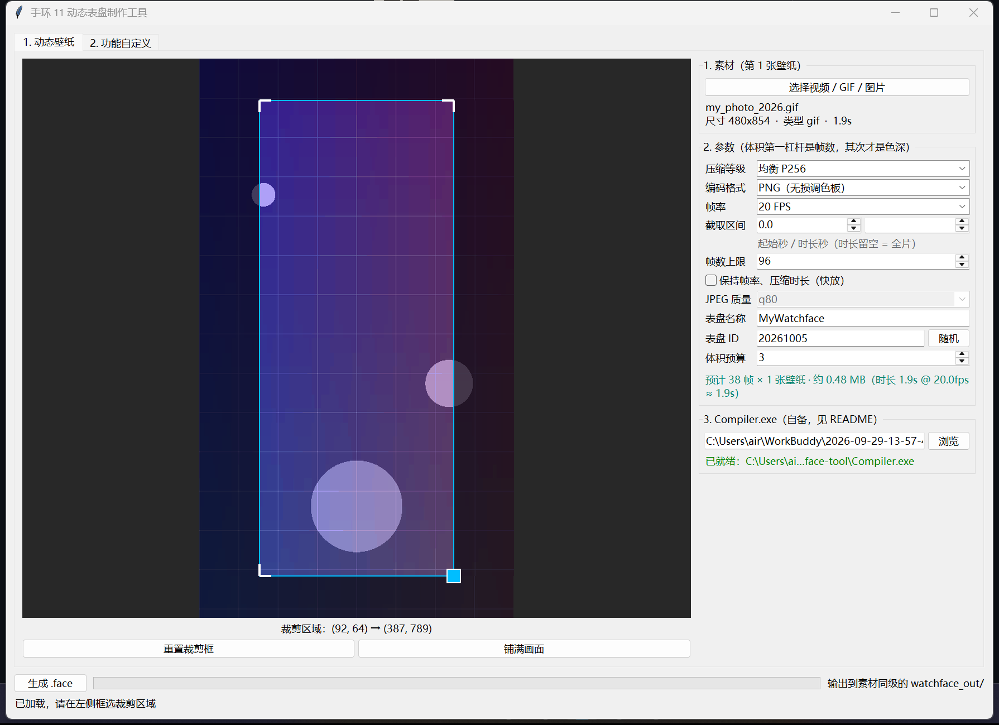
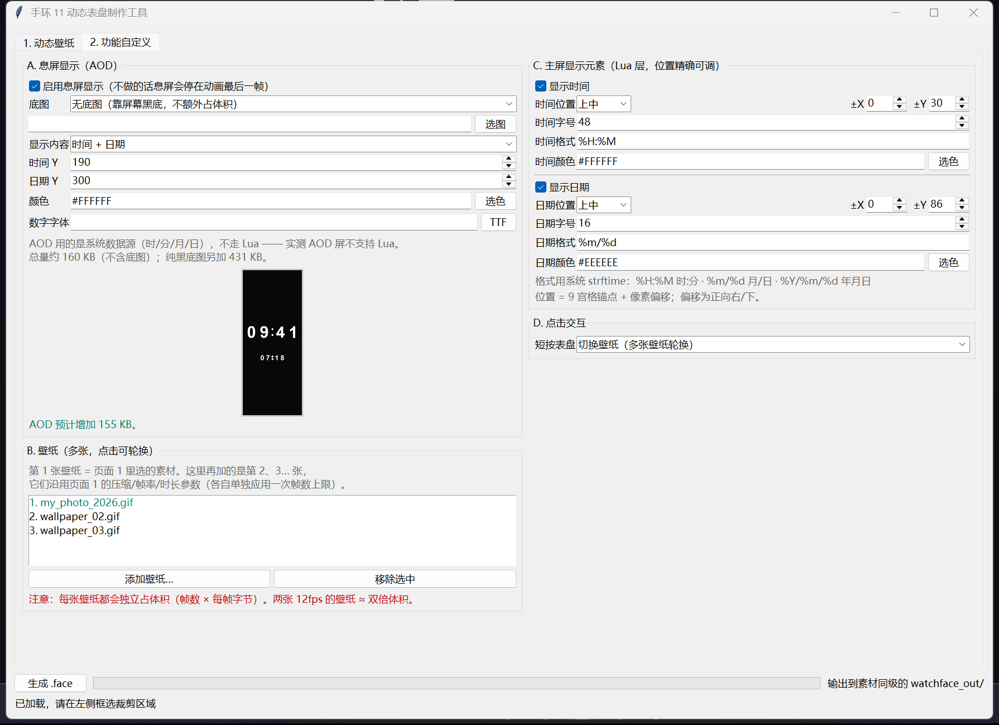
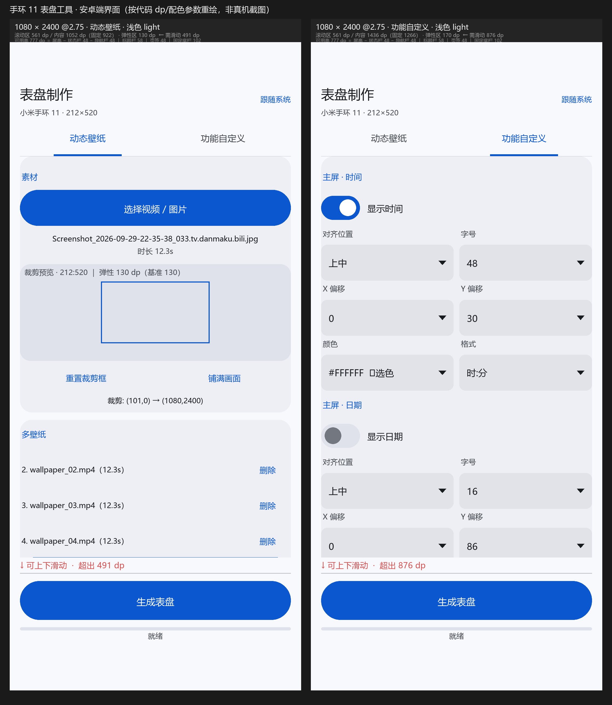
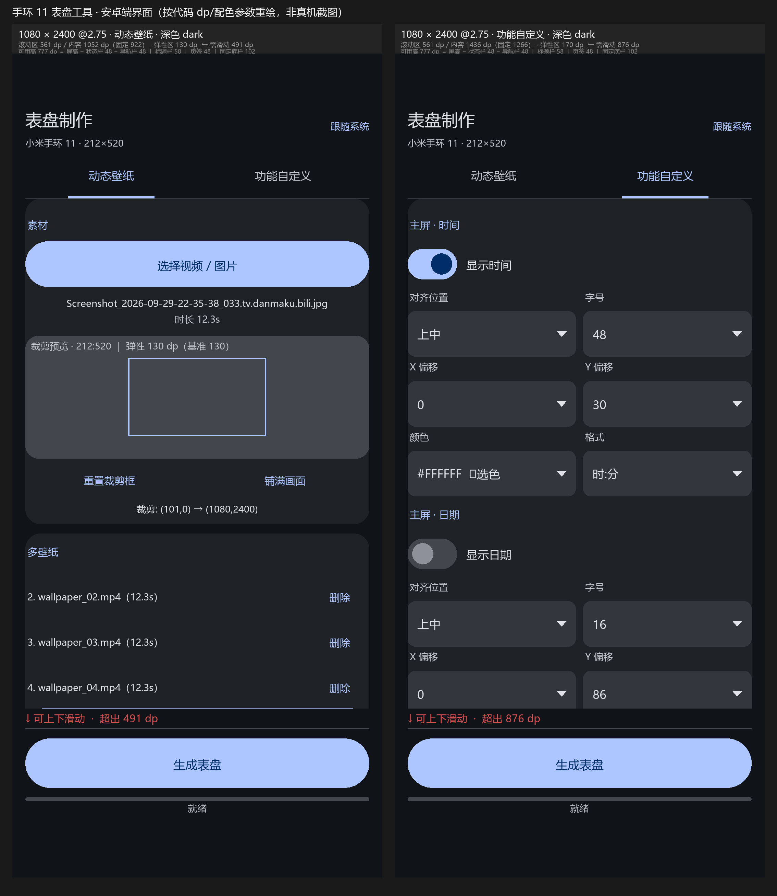

# miband11-watchface-maker

<div align="center">

[](https://github.com/AIR-pixel/miband11-watchface-maker/releases/latest)
[](./LICENSE)
[](https://www.python.org/)
[](https://github.com/AIR-pixel/miband11-watchface-maker/releases/latest)
[](https://github.com/AIR-pixel/miband11-watchface-maker)

[English](./README_EN.md) · **简体中文**

</div>

把**视频 / GIF / 静态图**一键做成可安装到**小米手环 11**（212×520，Vela OS）的**动态表盘** `.face`。
壁纸之外的部分也一并可配：**息屏 AOD、主屏时间日期、点击交互、多壁纸**。

提供 **Windows 版**和**安卓版**两条独立实现，同一套算法、同样的产物格式。

> ⚠️ 本项目是**非官方的第三方工具**，与小米公司无任何关联。生成表盘的安装需第三方工具配合，
> 请自行评估风险。详见[免责声明](#免责声明)。

---

## 速览

| | |
|---|---|
| **目标设备** | 小米手环 11 · 屏幕 212×520 · Vela OS（`DeviceType=466`） |
| **产物** | `.face`（可安装表盘） |
| **输入** | 视频（mp4/mov/mkv/webm/avi）· GIF · 静态图（png/jpg/bmp/webp） |
| **两条实现** | Windows（Python + tkinter）· 安卓（Kotlin 界面 + Java 核心） |
| **Windows 端依赖** | Python 3.8+ · Pillow · `ffmpeg`（仅视频）· `Compiler.exe`（自备） |
| **安卓端依赖** | 无 —— 纯代码拼装 `.face`，**不需要 `Compiler.exe`** |
| **体积预算** | 经验值 ≤ 3.5 MB，改参数时实时预估 |

---

## 目录

- [它解决什么问题](#它解决什么问题)
- [下载](#下载)
- [界面截图](#界面截图)
- [功能](#功能)
- [配置说明](#配置说明)
- [功能自定义详解](#功能自定义详解)
- [使用方法](#使用方法)
- [体积控制的三条结论](#体积控制的三条结论)
- [安装到手表](#安装到手表)
- [双端一致性怎么保证](#双端一致性怎么保证)
- [关于 AI 协助](#关于-ai-协助)
- [项目经验](#项目经验)
- [免责声明](#免责声明)
- [许可](#许可)
- [项目结构](#项目结构)（折叠）

---

## 它解决什么问题

小米手环 11 的**动态表盘必须走 Vela Lua（Lua + LVGL）**才能做，官方「相册表盘」只能放静态图。
而官方链路要求装 Vela IDE、手写 Lua、调 LVGL、再跑 `Compiler.exe` 打包 —— 门槛不低。

这个项目把整条链路收成一个界面操作：

```
导入视频/GIF/图片  →  框选裁剪区  →  调压缩/帧率/时长  →  生成 .face
```

三个关键点：

1. **框选裁剪** —— 任意素材自动吸附到 212:520，无黑边。
2. **体积可控** —— 表盘有体积预算（经验值 ≤ 3.5 MB），这个工具能精确控制到每一档，
   并且**改参数时实时显示预估体积**，不用反复试。
3. **安卓版不依赖 Compiler.exe** —— 官方编译器是 x86 Windows 二进制，安卓跑不了。
   安卓版用**纯代码按二进制格式直接拼装** `.face`，摆脱了这个依赖。

---

## 下载

| 平台 | 下载 | 说明 |
|---|---|---|
| **安卓** | [watchface-tool-android-v2.2.0.apk](../../releases/latest/download/watchface-tool-android-v2.2.0.apk) | 直接安装。Android 7.0+（minSdk 24） |
| **Windows** | [watchface-tool-pc-v2.2.0.zip](../../releases/latest/download/watchface-tool-pc-v2.2.0.zip) | 源码包，需自行装 Python 依赖 + 自备 `Compiler.exe` |

> 安卓版安装时系统可能提示「未知来源应用」，需在设置里允许。

---

## 界面截图

<table>
<tr>
<td align="center"><b>Windows · 页签 ① 动态壁纸</b><br>
<sub>框选裁剪 + 压缩/帧率/帧数 + 实时体积预估</sub><br>
</td>
<td align="center"><b>Windows · 页签 ② 功能自定义</b><br>
<sub>AOD 预览 · 主屏时间日期 · 交互 · 多壁纸</sub><br>
</td>
</tr>
<tr>
<td align="center"><b>安卓版 · 浅色</b><br>
<sub>Material 3，配色跟随系统</sub><br>
</td>
<td align="center"><b>安卓版 · 深色</b><br>
<sub>Android 12+ 从壁纸取色，低版本退回基线蓝</sub><br>
</td>
</tr>
</table>

> 安卓版这两张是**按源码里的 dp 与配色参数离线重绘**的效果图，不是真机截图（开发环境无安卓设备）。
> 布局与配色是照 `MainActivity.kt` / `Palette.kt` 逐项算出来并校验过的
> （见 [docs/项目经验.md](./docs/项目经验.md)）。Windows 版那两张是真机运行截图。

---

## 功能

| 功能 | 说明 |
|---|---|
| **多格式素材输入** | 视频、GIF、静态图（见[速览](#速览)） |
| **框选裁剪** | 拖拽选择保留区域，比例自动锁定 212:520；支持角点拖拽、滚轮缩放、双指缩放 |
| **截取区间** | 指定起始秒数与时长，只取素材的一段 |
| **帧率可选** | 6 / 8 / 12 / 16 / 20 / 24 / 30 FPS，或沿用源素材帧率 |
| **帧数上限** | 体积的第一杠杆。超出上限时二选一（见下） |
| **色深 6 档 / 编码 2 种** | 见[配置说明](#配置说明) |
| **快放模式** | 帧数触顶时可保持帧率、压掉播放时长（内容完整 + 流畅，代价是播放变快） |
| **实时体积预估** | 改任何参数立刻显示「预计 N 帧 · 约 X MB · 播放 Y s」，超预算标红 |
| **叠加时间日期** | 生成的 Lua 订阅系统时间并绘制；**位置、字号、颜色、格式都可调** |
| **息屏显示（AOD）** | 生成 `AOD/` 子工程。缺了它手环会**停在动画最后一帧** |
| **点击交互** | 短按表盘：切换壁纸 / 显隐时间日期 / 暂停动画 |
| **多壁纸** | 一次打包多张动态壁纸，短按轮换 |
| **自定义表盘名 / ID** | ID 可随机生成，避免与市集表盘撞车 |
| **命令行** | Windows 版支持纯 CLI，便于脚本化 / 批量生成 |

### 帧数触顶时：流畅度 × 时长只能保一个

这是最容易被忽略、但实际最常碰到的权衡。给定帧数上限后，
**抽帧和播放节奏是可以解耦的两件事**：

| 模式 | 抽帧 | 播放 | 结果 |
|---|---|---|---|
| **默认**（保时长、降帧率） | N 帧摊满整段 | 降下来的帧率 | 内容完整、时长不变，**明显掉帧** |
| **快放**（保帧率、压时长） | N 帧摊满整段 | 你指定的帧率 | **流畅**、内容完整，但播放变成 X 倍速 |

两者**抽的是同一批帧、体积完全相同**，区别只在生成的 `main.lua` 里一个 `period` 值。
所以「最小体积 + 流畅」是能同时拿到的，代价是时长被压掉。

实测：8 秒 / 24fps 素材压到 46 帧 → 默认播放 8.0s（5.75fps，卡）；快放播放 1.9s（24fps，流畅，4.17 倍速）。

---

## 配置说明

### 色深与编码（每帧实测，212×520）

| 档位 | 内部名 | 每帧 | 适用 |
|---|---|---|---|
| 高画质 RGB | `high` | 146.8 KB | 几乎不用（太大） |
| 均衡 P256 | `balanced` | 66.7 KB | 素材颜色极其丰富时 |
| 小体积 P128 | `small` | 53.0 KB | 画质优先 |
| 极限 P64 | `tiny` | **41.5 KB** | **推荐起点** |
| 极小 P32 | `micro` | 31.6 KB | 体积吃紧 |
| 微缩 P16 | `nano` | **20.4 KB** | 极限压缩，画面明显丢色 |
| JPEG q90 | `--fmt jpg` | 41.4 KB | 与 P64 同体积，但 P64 无损 —— 不如直接用 PNG |
| JPEG q85 | | 32.7 KB | 甜点区上沿 |
| JPEG q80 | | **27.5 KB** | **默认**，比 P64 PNG 小 34% |
| JPEG q70 | | 21.4 KB | 体积优先 |
| JPEG q60 | | 17.7 KB | 极限，噪点明显 |

**PNG 和 JPEG 不是替代关系，是两种不同性质的损失。**

| | 优点 | 缺点 |
|---|---|---|
| **P64 PNG** | 无损、平涂区干净、无噪点 | 只有 64 色，渐变 / 肤色处有**色带** |
| **JPEG q80** | 连续色调无色带、体积只有 P64 的 0.66 倍 | 有损，边缘有**蚊子噪点 / 块效应** |

经验：**真人 / 照片 / 渐变多的素材用 JPEG q80**；**动漫平涂 / 色块清楚的用 PNG P64**。

> P 系列是**无损调色板**（量化到 N 色后再无损存 PNG），代价是渐变区出现色带。
> 更细的实测数据（含分通道 PSNR、可复现脚本）见 [docs/体积与画质实测.md](./docs/体积与画质实测.md)。

<details>
<summary><b>JPEG 的两个反直觉细节</b></summary>

**① 甜点区是 q80~q85。** q90 以上体积反超 P64 PNG（41.4 vs 41.5 KB），
而 P64 是无损的 —— 那个档位不如直接用 PNG。

**② Windows 版关掉了 JPEG 的色度子采样（走 4:4:4）。** PIL 默认的 4:2:0 会把色度砍到
106×260，彩色边缘明显串色 —— 这是「JPEG 看起来糊」的主因。实测关掉只多 19% 体积，
色度 PSNR 却涨 2.5 dB，是性价比最高的一刀。

**安卓版做不到这点**：`Bitmap.compress` 固定 4:2:0，所以安卓导出的 JPEG 质量天花板低于 Windows 版。

</details>

### 帧率与帧数上限

- **帧率**：24 FPS 是流畅度边界（实测 33 FPS 卡顿、24 FPS 正常、16 FPS 更稳）。
  默认给 **12 FPS + 96 帧上限**，是为了避免 8 秒素材一上来就产出 7 MB 以上的表盘。
- **帧数上限**：默认 96。超出时的行为由「快放」开关决定（见上一节）。

### 其他

| 参数 | 默认 | 说明 |
|---|---|---|
| 截取起始 | 0 s | 从素材第几秒开始取 |
| 截取时长 | 全片 | 留空表示取到结尾 |
| 表盘名称 | MyWatchface | 显示在表盘选择器里 |
| 表盘 ID | 随机生成 | 10 位数字，随机会避开市集表盘 |
| 体积预算 | 3.5 MB | 仅用于预估时的标红提醒，不阻断生成 |

---

## 功能自定义详解

界面第 2 页的四组设置。**主屏的一切都由 Lua 决定**（`.fprj` 里只有一个全透明挂载点），
所以时间 / 日期 / 交互改的是生成的 `main.lua`；**息屏屏（AOD）不支持 Lua**，只能走 fprj 控件层。

### 息屏显示（AOD）

不做 AOD 的话，息屏时手环**停在动画最后一帧**（既费电又难看）。加上它就好了。

生成物是一个**同级子工程**，不单独编译，主工程打包时一并编入：

```
MyFace.fprj + images/ + app/lua/
AOD/
├── AOD.fprj          ← 目录名与文件名都固定，编译器内建这条路径
└── images/
```

AOD 屏**不能跑 Lua**（实测：往 `AOD.fprj` 里写 `Shape=34` 挂载点，它的 lua 不会入包，
产物只多 88 字节）。所以 AOD 上的时间靠 `Shape=32` 数字位图 + `Value_Src` **系统数据源**。

<details>
<summary><b>数据源 ID 表</b></summary>

| 数据源 | ID | 数据源 | ID |
|---|---|---|---|
| 时 | `0811` | 月 | `1012` |
| 分 | `1011` | 日 | `1812` |
| 秒 | `1811` | 星期 | `2012` |
| 电量 | `0841` | 心率 | `0822` |

ID 是十六进制字面量去掉 `0x` 与前导零；取自 Mi-Create 的 `sources.json` 里 `xiaomi_band_10` 一栏，
即本工具用的 `DeviceType=466`。编译器只存数字、不校验，由系统在运行期解析。

</details>

默认「时间 + 日期」≈ **+155 KB**。四个要点：

- **默认不放全屏黑底**。AMOLED 黑像素不发光，屏幕本身就是黑的，省下 431 KB。
  想要保险可选「纯黑底图」（那就 +431 KB）。
- **数字字号就是钱**：46×64 的时分数字（11 张图）≈ 127 KB，20×28 的日期 ≈ 24 KB。
- **同一张 BitmapList 被多个控件复用时只算一次** —— 两个 `Shape=32`（时、分）合起来只付一份位图钱。
- **字形来自内嵌字库**（`tools/gen_aod_font.py` 生成，两端同源），不再读系统字体 ——
  所以 Windows 与安卓生成的 AOD 数字**逐像素一致**。

<details>
<summary><b>AOD 体积代价（逐项实测）</b></summary>

| 项 | 代价 |
|---|---|
| AOD 空屏 | +88 B |
| 每个 `Shape=30` 图片 | `宽 × 高 × 4 + 60` B |
| 每个 `Shape=32` 数字组 | `图宽 × 图高 × 4 × 图数`（多控件共用同一 `BitmapList` 会去重） |

一个反直觉的实测：**主屏**上加 `Shape=30` 小图标会被合成为整屏位图（+431 KB/个），
**AOD 屏**不会（按图片实际尺寸算）。所以「AOD 上放小图标很便宜」和「主屏上放小图标很贵」不矛盾。

</details>

### 主屏时间 / 日期

| 项 | 说明 |
|---|---|
| 显示开关 | 时间、日期各自独立开关 |
| 位置 | 9 宫格锚点（左上 / 上中 / … / 右下）+ X/Y 像素偏移 |
| 字号 | 8–200 |
| 颜色 | 取色器或直接填 `#RRGGBB` |
| 格式 | 系统 `strftime`：`%H:%M` `%Y/%m/%d` `%p %I:%M` 都行 |

这部分走 Lua 的 `lvgl.Label` + `lvgl.ALIGN`，**不占额外体积**（字体在系统里），
定位是像素级的，比 fprj 控件层灵活得多。

### 点击交互

| 选项 | 行为 |
|---|---|
| 无 | 不响应短按 |
| 切换壁纸 | 多张壁纸之间轮换（只有 1 张时自动降级为「无」） |
| 显示 / 隐藏时间日期 | 短按切换信息层显隐 |
| 暂停 / 继续动画 | 短按冻结画面（省电小技巧） |

实现是 `root:add_flag(lvgl.FLAG.CLICKABLE)` + `onevent(lvgl.EVENT.SHORT_CLICKED)`，
子控件事件靠 `FLAG.EVENT_BUBBLE` 冒泡到根对象。

> **跳转到系统 App（天气 / 闹钟 / 心率）在本代手环上做不到**，所以没有这个选项。
> 实测：本机编译器在 `DeviceType=466` 下**完全忽略** `btn[...]` 控件名语义 ——
> 把控件改名成 `btn[weather]` / `btn[alarm]` / `btn[hrm]`，五个产物**字节完全相同**。
> 那是手环 8 Pro / 红米手表那几代的能力，Lua 侧也没有对外跳转的 API。**两条路都不通。**

### 多壁纸

第 1 张壁纸就是第 1 页里选的素材；第 2 张起在这里加。它们**沿用第 1 页的压缩 / 帧率 / 时长参数**，
每张单独应用一次帧数上限。命名：第 1 张 `face_01.png…`，第 2 张 `w2_01.png…`，以此类推。

> **每张壁纸独立占体积**。两张 12fps 的壁纸 ≈ 双倍体积 —— 生成前预估行会算进去。

### 省电钩子

<details>
<summary>为什么同时挂 <code>pageOnPause</code> 和 <code>ScreenStateChangedCB</code></summary>

```lua
function ScreenStateChangedCB(pre, now, reason)
    if pre ~= "ON" and now == "ON" then resumeActive()
    elseif pre == "ON" and now ~= "ON" then pauseAll() end
end
```

进 AOD 时表盘页面**并没有被切走**，`pageOnPause` 很可能不触发 ——
只靠它会让动画在息屏下继续跑，续航直接崩。所以两个都要。

</details>

---

## 使用方法

### Windows 版

**1. 环境准备**

```bash
pip install -r watchface-tool/requirements.txt   # Pillow + tkinterdnd2
```

- 处理**视频**需要 `ffmpeg`（GIF / 图片不需要），装好后加入 PATH。
- 打包 `.face` 需要 **`Compiler.exe`**，本项目不分发，需自备（见 [NOTICE](./NOTICE)）。

**2. 启动**

```bash
cd watchface-tool
python main.py
```

**3. 操作流程**

界面分**两个页签**，底部「生成 .face」固定贴底：

| 页签 | 内容 |
|---|---|
| **① 动态壁纸** | 1. 素材 · 2. 参数 · 3. Compiler.exe |
| **② 功能自定义** | A. 息屏显示（AOD）· B. 壁纸（多张）· C. 主屏显示元素 · D. 点击交互 |
| **底部（固定贴底）** | 生成按钮 · 进度条 · 状态行 |

**页签 ①**：拖入素材（或点「选择素材」）→ 左侧**框选裁剪区域**（拖动移动、拖角点缩放、滚轮缩放）
→ 右侧调压缩程度 / 编码格式 / JPEG 质量 / 帧率 / 截取区间 / 帧数上限 / 快放开关
→ 看「预估」行确认体积（超预算标红）
→ 在「3. Compiler.exe」处指定路径（会记住，存到 `~/.watchface_tool.json`）。

**页签 ②** 四组（全部可选，不做就是纯动态壁纸）：
**A. 息屏显示（AOD）** —— 开关、底图（无 / 纯黑 / 自定义图片）、内容（不显示 / 时间 / 时间+日期）、
时间 Y、日期 Y、颜色，下方是**实时预览**与体积预估；
**B. 壁纸（多张，点击轮换）** —— 列表 + 「添加壁纸…」「移除选中」；
**C. 主屏显示元素** —— 时间 / 日期各自开关，各带 9 宫格锚点 + ±X/±Y 偏移、字号、strftime 格式、颜色（含选色板）；
**D. 点击交互** —— 短按表盘：无 / 切换壁纸 / 显示·隐藏时间日期 / 暂停·继续动画。

最后点底部「生成 .face」，产物默认输出到素材同目录下的 `watchface_out/`。

### 安卓版

**1. 安装** —— 下载 [watchface-tool-android-v2.2.0.apk](../../releases/latest/download/watchface-tool-android-v2.2.0.apk) 安装（Android 7.0+）。

**2. 操作流程** —— 同样是两页签 + 底部固定生成按钮。

| 页签 | 控件 |
|---|---|
| **① 动态壁纸** | 选素材 · 裁剪区（拖动/角点/双指缩放，含「重置裁剪框」「铺满画面」）· 多壁纸（≤8 张，沿用同一套参数、裁切固定「全高居中」）· 压缩 6 档 · 帧率 7 档 · 编码 2 种 · 帧数上限 7 档 · JPEG 质量 5 档（非 JPEG 时置灰）· 起始/时长 · 快放开关 · 预估行「N 张 / 共 N 帧 · 约 X MB（含固定开销 431KB）」 |
| **② 功能自定义** | 主屏时间 / 日期（各自开关、9 种对齐、X/Y 偏移、字号、颜色预设、strftime 格式）· 点击表盘（切壁纸 / 显隐时间日期 / 暂停动画）· 息屏 AOD（开关、底图、内容、时间行与日期行 Y、颜色，**带预览图**与体积预估） |
| **底部（固定贴底）** | 生成按钮 · 进度条 · 状态 |

产物存到 `Android/data/face.tool/files/faces/`。

> 「生成」按钮放在滚动区**外面**固定贴底，任何屏幕尺寸 / 字号下都点得到 ——
> 旧版把所有控件竖着塞在一屏里，小屏上按钮会被顶到屏幕外。
> 裁剪预览与 AOD 预览用「基准高 + 权重」吃掉富余高度：放得下时参数按自然高度铺开，
> 放不下时预览退到基准高、整页滚动。
>
> 安卓版**不需要 `Compiler.exe`**，它用纯代码拼装 `.face`。

**3. 从源码自行构建**（不需要 Android Studio，不需要 Gradle）

```bash
cd watchface-android
bash fetch_kotlinc.sh    # 首次：拉一套最小 Kotlin CLI（约 62 MB，装在 .kotlinc/，已 gitignore）
# 需要：Android SDK build-tools（含 aapt2/d8/zipalign/apksigner）+ JDK 17+
bash build.sh
```

流程：`aapt2 link → javac(Java) → kotlinc(Kotlin) → R8 → 塞 classes.dex → zipalign → apksigner`，
产物 `watchface-tool.apk`。

<details>
<summary><b>构建链路的三个要点</b></summary>

**界面是 Kotlin、核心算法是 Java**（零 Android 依赖，桌面 JVM 也能跑），两者在手工链里混编，不需要 Gradle。

**R8 是必需的，不是可选项。** Kotlin 会带进 kotlin-stdlib，直接打包 APK 会从 49 KB 涨到 2.1 MB。
脚本默认过一遍 **R8（full mode）**，把 1108 个 `kotlin/*` 类整棵摇掉 ——
实测成品与纯 Java 版**同尺寸**。`NOR8=1 bash build.sh` 可跳过压缩换构建速度（约 10 s → 约 50 s）。
R8 用的是 Android SDK 自带的 `cmdline-tools/*/lib/r8.jar`，不需要额外下载。

**几条容易踩的坑，脚本里已处理：**

1. `d8.bat` / `apksigner.bat` / R8 靠 **`JAVA_HOME`** 定位 JDK（PATH 里的 `java` 可能是别的版本）
   —— 脚本里显式 `export JAVA_HOME=...`。
2. Git Bash 下 Windows 路径要用 `/c/...` 形式，且 `javac` 用 `--release 8` 才能产出 minSdk 24 能用的字节码。
3. **classpath 用 `;` 拼接时 Git Bash 不做路径转换** —— `/c/...` 形式 Java 认不出来，
   症状是 `ClassNotFoundException: org.jetbrains.kotlin.cli.jvm.K2JVMCompiler`（看着像 jar 坏了）。
   脚本里一律用 `cygpath -w` 转成 `C:\...`。
4. kotlinc 的 `-no-stdlib` 只是关掉「自动从 kotlin-home 找 stdlib」，**不代表不用 stdlib** ——
   还得自己把 `kotlin-stdlib.jar` 写进 `-classpath`，否则满屏 `cannot access built-in declaration 'kotlin.String'`。

</details>

### 命令行

Windows 版支持无界面生成：

```bash
cd watchface-tool
python main.py --cli \
  --src 素材.gif --level tiny --fps 12 --max-frames 96 \
  --fmt jpg --jpg-quality 80 \
  --clip-start 0 --clip-dur 4 \
  --name MyFace --compiler "path/to/Compiler.exe"
```

<details>
<summary><b>参数表</b>（点击展开）</summary>

**基础参数**

| 参数 | 说明 |
|---|---|
| `--src` | 素材路径（必填） |
| `--level` | `high` / `balanced` / `small` / `tiny` / `micro` / `nano`，默认 `balanced` |
| `--fps` | 目标帧率；省略则用源素材帧率 |
| `--clip-start` / `--clip-dur` | 起始时间 / 截取时长（秒）；时长省略取到结尾 |
| `--max-frames` | 总帧数上限，默认 96 |
| `--fmt` | `png` / `jpg`，默认 `png` |
| `--jpg-quality` | JPEG 质量，默认 80（仅 `--fmt jpg` 生效） |
| `--speedup` | 保持帧率、压缩时长（快放）；默认是保时长、降帧率 |
| `--crop` | 裁剪框 `x0,y0,x1,y1`；省略则默认居中 |
| `--name` / `--id` | 表盘名称 / ID |
| `--compiler` | `Compiler.exe` 路径（必填） |
| `--out` | 输出目录 |
| `--no-time` | 不叠加时间 |

**功能自定义参数**

| 参数 | 说明 |
|---|---|
| `--date` | 叠加日期（默认只叠加时间） |
| `--time-fmt` / `--date-fmt` | strftime 格式，默认 `%H:%M` / `%m/%d` |
| `--time-pos` / `--date-pos` | LVGL 对齐名（`TOP_MID`、`CENTER`、`BOTTOM_RIGHT`…），默认 `TOP_MID` |
| `--time-ofs` / `--date-ofs` | 像素偏移 `dx,dy`，默认 `0,30` / `0,86` |
| `--time-size` / `--date-size` | 字号，默认 48 / 16 |
| `--time-color` / `--date-color` | 颜色 `RRGGBB`，默认 `FFFFFF` / `EEEEEE` |
| `--tap` | `none` / `cycle` 切壁纸 / `info` 显隐信息 / `anim` 暂停动画 |
| `--wall <路径>` | 额外壁纸，可重复 |
| `--aod` | 生成息屏显示子工程 |
| `--aod-content` | `none` / `time`（默认）/ `both` 时间+日期 |
| `--aod-bg` | `none`（默认，不占体积）/ `black` / `custom` |
| `--aod-bg-image` | `--aod-bg custom` 时的图片路径 |
| `--aod-time-y` / `--aod-date-y` | AOD 时间 / 日期行的 Y 坐标，默认 200 / 300 |
| `--aod-color` | AOD 数字颜色 `#RRGGBB`（字形来自内嵌字库 `tools/gen_aod_font.py`） |

</details>

例：双壁纸 + AOD + 点按切壁纸

```bash
python main.py --cli \
  --src w1.gif --wall w2.gif \
  --level tiny --fps 8 --max-frames 48 \
  --date --date-fmt "%Y/%m/%d" --tap cycle \
  --aod --aod-content both \
  --name MyFace --compiler "path/to/Compiler.exe"
```

---

## 体积控制的三条结论

1. **帧数才是主要杠杆，色深只是次要杠杆。**
   P256 → P64 每帧只降 38%；而帧率 24 → 8 FPS 让**帧数**直接降 67%、体积同比例下降。
   一段 8 秒素材在 24 FPS 下有 192 帧，即使 P64 也有 7.8 MB —— 这时应该先砍时长 / 帧率，
   而不是继续压色深。

2. **`.face` 里还有 431 KB 的固定开销**（尾部位图 212×520 RGBA8888，用于表盘选择器预览）。
   帧数很少时它可能比全部帧数据还大，所以别指望把几十 KB 的小表盘再压下去。

3. **想进一步缩小，按这个顺序调**：
   **截取时长 → 帧率 → 帧数上限 → 色深档位 → 编码格式（JPEG）**。

更细的实测数据（含分通道 PSNR、脚本可复现）见 [docs/体积与画质实测.md](./docs/体积与画质实测.md)。

---

## 安装到手表

生成的 `.face` 需要借助**第三方表盘工具**（配合 Mi Fitness 修改版）或 Mi Fitness 官方
表盘通道安装到小米手环 11。

**本工具只负责生成 `.face`，不涉及安装链路，也不对安装过程提供支持。**
请自行确认你的安装方式与设备版本匹配。

---

## 双端一致性怎么保证

`main.lua` 的生成逻辑、AOD 的控件布局与描述块、`.face` 的拼装，在**两侧各有一份实现**
（Python 与 Java/Kotlin）。这种「逐行照抄」最容易骗自己 —— 看着一样，字节不一样。

所以仓库里带了一个**跨语言差分回归**：`python tools/diff_face.py`（约 40 s，只需 JDK + Pillow）。
它用同一份用例表让两份实现各跑一遍，然后**逐字节**比对：

| 阶段 | 比对对象 | 例数 |
|---|---|---|
| `lua` | 生成的 `main.lua` 全文 | 12 |
| `aod` | AOD 控件表 + 描述块全部记录 | 12 |
| `asm` | **整份 `.face` 的每一个字节**（含 AOD 与对齐边界） | 21 |
| `font` | **AOD 数字位图的每一个像素** | 26 |

比对全部字节而不是「关键字段」是有原因的：这个回归抓到的四个 bug（尾部对齐只做了一半、
偏移量相对 / 绝对搞混、某个分支从没被执行过、一行 `append` 缩进错级多出假控件）
**全都**发生在「关键字段看着都对」的地方。详见 [docs/项目经验.md](./docs/项目经验.md) 的 Bug 4/5/6。

⚠️ 覆盖不到的是**与官方 `Compiler.exe` 的一致性**：那需要本体，本项目因授权不分发，
所以那条证据是实测记录、不是可重跑脚本。

---

## 关于 AI 协助

**本项目在开发过程中大量使用了 AI 协助。** 这一点明确写在这里，不做隐瞒。

- **代码 / 文档 / 逆向分析**：大部分由 AI（Claude、DeepSeek 等）在人工指导下生成与迭代。
  人工负责定义需求、判断方案、验证结果、在 AI 走偏时纠正方向。
- **实测数据**：`docs/` 里的所有数字都是**真机实跑出来的**，不是 AI 估算的。
  体积 / 画质（`tools/bench_quality.py`）、格式结构（`tools/verify_face.py`）、
  **两份实现是否等价**（`tools/diff_face.py`）都有可复现脚本；
  只有 AOD 逐项开销那组是一次性受控实验，脚本未随仓库发布。

**这意味着什么：**

- ✅ 实际行为以**实测为准**，不以文档描述为准。文档与代码不一致时，是文档的错。
- ⚠️ 未经充分人工审查的代码可能有隐藏缺陷。已在具体场景下验证可用，
  但**不保证覆盖所有输入组合**。
- ⚠️ 涉及安全、隐私、法律合规的场景请自行评估。

如果你在意「AI 写的代码能不能信」——这个项目的态度是：**用可复现的实测数据说话**。
关键结论都附了原始数据，能做成脚本的部分也一并给了，欢迎自己复跑打脸。

---

## 项目经验

开发过程中的踩坑记录、技术结论和方法论整理在 **[docs/项目经验.md](./docs/项目经验.md)**，其中包括：

- `.face` 格式逆向的完整过程与关键突破点
- 体积优化的三层杠杆，以及「为什么直觉是错的」（色深不是主杠杆）
- 一个真实 bug 的根因分析：缩放框「不跟手」（增量 vs 常量混用）
- JPEG 质量问题的根因定位（色度子采样）
- 无 Gradle 构建安卓 APK 的链路与两个必踩的坑
- 复盘：AI 协作中哪些地方有效、哪些地方容易出问题

---

## 免责声明

**请在使用前完整阅读本节。**

1. **非官方工具。** 本项目是个人开发的第三方工具，与小米公司（Xiaomi Inc.）及任何关联公司
   **无任何关系**，未获其授权、赞助、认可或技术支持。"小米"、"Xiaomi"、"Mi Band"、"Vela"
   等为其各自权利人的商标。

2. **使用风险自负。** 生成的 `.face` 文件、以及你将其安装到设备上的行为**完全由你自行承担风险**。
   作者不对以下负责：设备损坏 / 变砖、数据丢失、保修失效；显示异常、黑屏、卡顿、耗电异常；
   第三方安装工具导致的任何问题；账号被封禁或限制。

3. **不提供安装支持。** 本工具只负责生成 `.face`。安装需第三方工具配合，不在本项目范围内，
   作者不提供相关指导。

4. **合规责任在你。** 你对自己生成和分发的内容负全部责任。请勿用未经授权的视频、图片、音乐、
   角色形象等受版权保护的素材制作表盘，更不要公开分发这类产物 ——
   把动漫、影视、游戏角色做成表盘分享，很多情况下**属于侵权**。

5. **第三方组件。** 本项目依赖 `Compiler.exe`（未随仓库分发，需自备）等组件，
   授权状况见 [NOTICE](./NOTICE)。`Compiler.exe` 的来源仓库无开源协议，且本质是从官方 IDE
   提取的产物，**公开分发包含它的打包产物前，应自行评估法律风险**。

6. **无担保。** 本软件按"原样"提供，不附带任何明示或暗示的担保，包括但不限于 merchantability
   或 fitness for a particular purpose 的担保。详见 [LICENSE](./LICENSE)。

7. **AI 生成内容。** 本项目大量使用 AI 协助开发（见[关于 AI 协助](#关于-ai-协助)）。
   代码与文档可能存在 AI 引入的错误，**请自行审查后再用于关键场景**。

8. **保留权利。** 作者保留在不对用户承担任何义务的前提下，随时修改、停止维护或删除本项目的权利。

> **一句话**：这是给你自己折腾用的玩具工具，玩得开心，但出了事别找作者。

---

## 许可

本项目自有源码以 **MIT License** 发布，见 [LICENSE](./LICENSE)。

第三方组件、参考来源、商标归属见 [NOTICE](./NOTICE)。

> 注意：MIT 只覆盖本仓库中包含的源码。`Compiler.exe` 不在其中（也未随仓库分发），
> 它的授权状况不受本项目影响。

---

<details>
<summary><b>项目结构</b>（点击展开）</summary>

```
miband11-watchface-maker/
├── README.md                  本文档（中文）
├── README_EN.md               English version
├── LICENSE                    MIT
├── NOTICE                     第三方来源与合规说明
├── docs/
│   ├── face格式规范.md          .face 二进制格式（逆向所得，完整字段表）
│   ├── 体积与画质实测.md        全部实测数据
│   ├── 项目经验.md             踩过的坑、结论、方法论
│   └── images/                 README 里的界面截图
│       ├── win-1-wallpaper.png    Windows 页面 1（真机运行截图）
│       ├── win-2-function.png     Windows 页面 2（真机运行截图）
│       ├── android-light.png      安卓版浅色（按源码 dp 与配色离线重绘）
│       └── android-dark.png       安卓版深色（同上）
├── tools/
│   ├── verify_face.py          .face 结构检查器（只读，认得 AOD 产物的布局）
│   ├── bench_quality.py        体积 / 画质实测脚本
│   ├── lint_lua.py             给生成的 main.lua 做语法校验（全参数组合）
│   ├── diff_face.py            **跨语言差分回归**：Python 实现 ↔ JVM 实现逐字节对拍
│   ├── gen_aod_font.py         生成两端同源的 AOD 内嵌字库
│   └── diff/                   上者的用例表、JVM 驱动与 Python 参考实现
├── watchface-tool/             Windows 版（Python + tkinter）
│   ├── main.py                 入口（GUI / --cli）
│   ├── gui/
│   │   ├── window.py           主窗口（两页：动态壁纸 / 功能自定义）
│   │   ├── crop_canvas.py      裁剪预览画布（tk.Canvas 手绘）
│   │   └── scroll_frame.py     可滚动容器（页面 2 用）
│   └── watchface_tool/
│       ├── constants.py        常量、格式定义与数据源 ID 表
│       ├── extract.py          视频 / GIF / 图片 → 帧序列 + 帧数规划
│       ├── crop.py             框选吸附到 212:520
│       ├── quantize.py         压缩与编码（PNG / JPEG）
│       ├── lua.py              生成 main.lua（动画 + 时间日期 + 交互 + 省电钩子）
│       ├── aod.py              生成 AOD 息屏子工程（数字位图 + 数据源绑定）
│       ├── aod_font.py         AOD 内嵌字库（由 tools/gen_aod_font.py 生成）
│       ├── fprj.py             生成 .fprj（UTF-16 XML）
│       ├── face_builder.py     纯代码拼装 .face（不依赖 Compiler.exe）
│       ├── build.py            调用 Compiler.exe + 回写表盘 ID
│       └── pipeline.py         编排
└── watchface-android/          安卓版（Kotlin 界面 + Java 核心）
    ├── build.sh                无 Gradle 构建脚本（javac + kotlinc + R8）
    ├── fetch_kotlinc.sh        拉一套最小 Kotlin CLI
    ├── r8-rules.pro            R8 保留规则
    ├── app/
    │   ├── AndroidManifest.xml
    │   └── src/face/tool/
    │       ├── MainActivity.kt  主界面（两页签，Kotlin）
    │       ├── CropView.kt      裁剪控件（Kotlin）
    │       ├── AodPreviewView.kt 息屏画面预览（Kotlin）
    │       ├── AodRenderer.java 把 AOD 布局画成位图
    │       └── FaceGenerator.java  编排（Java）
    ├── core/face/              零 Android 依赖的核心算法（Java）
    │   ├── FaceBuilder.java    拼装 .face（含 AOD，与 Python 版逐字节等价）
    │   ├── Quantizer.java      调色板量化（中位切分 + Floyd-Steinberg）
    │   ├── PngEncoder.java     PNG 编码（含调色板）
    │   ├── AodGen.java         AOD 纯逻辑（布局 / 描述记录 / 体积预估）
    │   ├── AodFont.java        AOD 内嵌字库（由 tools/gen_aod_font.py 生成）
    │   └── LuaGen.java         生成 main.lua
    └── test/face/              核心算法自测
```

</details>
